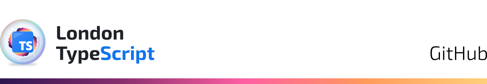

<picture>
  <source media="(prefers-color-scheme: dark)" srcset="github-dark-band-bottom-d3c15b6e.svg">
  
</picture>

## Intro

London TypeScript is a meetup of over 1,100 members. You can join up and find out more about us and our past events on our official [Meetup page](https://www.meetup.com/london-typescript-meetup/).

Our next 2026 event is currently being organised.

I’m [Nnsée](https://github.com/nnseenain) the organiser, and over the last couple of months I’ve been working on getting our first official GitHub ready for our members to contribute to.

The repos here are all written in TypeScript (naturally) and represent the systems behind the meetup: from websites to design systems and more. In the future there will also be ones for hackathons and coding sessions.

The plans, issues and decisions are all public, so feel free to look around. Contributors will be invited in once the platforms are ready.

 

## Repos

Each repo is named after a London landmark that fits its purpose.

### Foundation

---

#### [Temple Bar](https://github.com/londontypescript/temple-bar) 

Temple Bar is the foundation every London TypeScript repo runs on, its own development included. It helps prevent agentic drift through enforcement rather than prose: git hooks, a quality gate and GitHub rules refuse what an agent may never do. A judge stops agents changing those rules. It also sets one workflow, from plan to pull request, that any TypeScript project on GitHub using pnpm can adopt.

### Sites

---

#### [Grand Union](https://github.com/londontypescript/grand-union) 

Grand Union is London TypeScript’s single-definition, multi-renderer platform for all our sites: each page is written once and rendered as a website, a 3D site, a terminal site over SSH and a PDF. Pages are built from a shared vocabulary of semantic React components. Each renderer, such as React Three Fiber for 3D or Ink for SSH, implements that vocabulary, and the compiler refuses any renderer that misses a piece.

#### [Little Venice](https://github.com/londontypescript/little-venice) 

Little Venice is London TypeScript’s official website, londontypescript.com, built with the logos and artwork from Tate Modern. It’s a web-only stop-gap until Grand Union, our multi-renderer platform, reaches its MVP.

### Studios

---

#### [Tate Modern](https://github.com/londontypescript/tate-modern) 

Tate Modern is London TypeScript’s design studio. It houses our logos, character designs and illustrations, all defined in TypeScript, along with our official design guidelines and colour systems. Its studio apps let you tailor each design and export it in the formats our repos, events and websites need.

#### [West End](https://github.com/londontypescript/west-end) 

West End is London TypeScript’s animation studio, bringing Tate Modern’s character designs to life in the videos, posters and stills used at our events, on our websites and on social media. Rigs, poses and animations are written in our own declarative TypeScript DSL and rendered in Godot, in 2D and 3D, with posters and stills drawn from the same files as SVG.

### Tooling

---

#### [Fleet Street](https://github.com/londontypescript/fleet-street) 

Fleet Street is a Claude Code mod for working across London TypeScript’s repos. It adds a live panel above the prompt bar showing the repo and its milestone, usage, pull requests, sub-sessions, subagents and background tasks.
